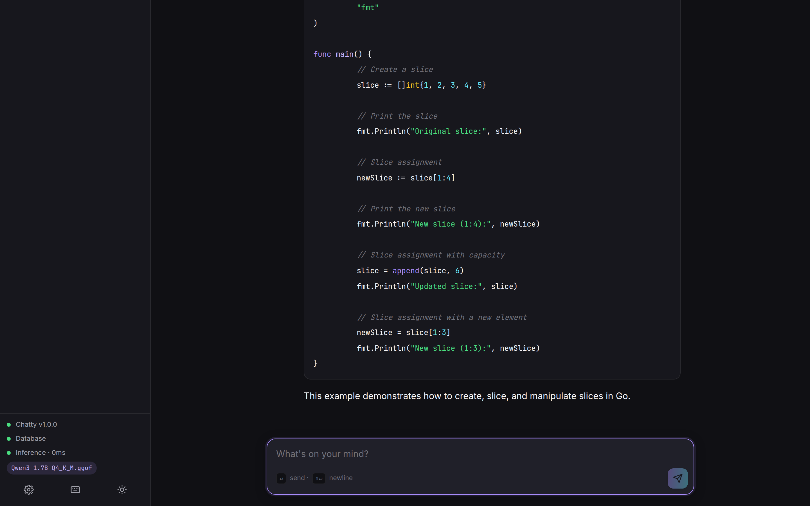

# Chatty

> **Your thoughts, amplified.**

Chatty is a self-hosted, premium-feeling AI chat interface for the local **Mimir** inference
service (Qwen). It is designed to feel like a modern product — ChatGPT's familiarity, Linear's
precision, Raycast's speed — while staying lightweight: a single static Go binary, PostgreSQL,
and Docker.



---

## Highlights

- 🖤 **Beautiful dark UI** (with a complementary light theme) — no framework, no CDN, everything embedded.
- ⚡ **Real-time streaming** over Server-Sent Events with incremental Markdown + syntax highlighting.
- 🧠 **Mimir / Qwen integration** with thinking **disabled by default** (llama.cpp `chat_template_kwargs`).
- 🗂 **Durable conversations** in PostgreSQL — search, rename, archive, export (Markdown/JSON), independent context per thread.
- ⌨️ **Keyboard-first** (⌘K search, ⌘⇧O new, Esc stop, ⌘↵ send, ⌘B sidebar).
- 🩺 **Real health & analytics** computed from Postgres (`/health`, `/api/stats`).
- 🐳 **One-command deploy**: `chatty` + `chatty-db`, reusing the existing Mimir Docker network.
- 🔒 **No auth** by design (it's a personal, network-scoped tool) — PostgreSQL is never published to the host.

## Quick start

```bash
cp .env.example .env            # then set CHATTY_DB_PASSWORD to a long random secret
docker compose up -d --build    # starts chatty + chatty-db, joins the mimir_mimir network
```

Open the app:

| Network | URL |
|---|---|
| LAN | `http://<host-lan-ip>:3333` |
| Tailscale | `http://<tailscale-ip>:3333` |
| Localhost | `http://localhost:3333` |

> Chatty reaches the running Mimir inference container at `http://inference:8080/v1` via the
> shared external Docker network `mimir_mimir`. **It never deploys a second model.**

See [docs/deployment.md](docs/deployment.md) for the full guide, and `make help` for tasks.

## Architecture (at a glance)

```
Browser (embedded vanilla JS SPA)
      │  REST + SSE
      ▼
Go server  ──▶  PostgreSQL (chatty-db)      conversations · messages · usage_events · settings
      │
      └──▶  Mimir llama-server (Qwen3)  —  OpenAI-compatible /v1/chat/completions (streaming)
```

Full details in [docs/architecture.md](docs/architecture.md). The complete REST contract is in
[docs/api.md](docs/api.md) and machine-readable in [docs/openapi.yaml](docs/openapi.yaml).

## Configuration

All deployment configuration is via environment variables (see [.env.example](.env.example)).
The web **Settings → Model** panel exposes only a validated subset (temperature, max tokens,
thinking, context length); infrastructure config stays in the environment.

| Variable | Default | Purpose |
|---|---|---|
| `APP_PORT` | `3333` | Listen port (0.0.0.0) |
| `DATABASE_HOST/PORT/NAME/USER` | `chatty-db/5432/chatty/chatty` | Postgres connection |
| `CHATTY_DB_PASSWORD` | — | Shared DB password (app + Postgres) |
| `MIMIR_BASE_URL` | `http://inference:8080/v1` | Mimir OpenAI-compatible base |
| `MIMIR_MODEL` | *(empty = auto-discover)* | Model id |
| `MIMIR_THINKING` | `false` | Qwen3 reasoning on/off |
| `MIMIR_BACKEND` | `auto` | Request-compat selector (`llamacpp`) |
| `CHAT_TEMPERATURE` | `0.7` | Sampling temperature |
| `CHAT_MAX_TOKENS` | `1024` | Max completion tokens (auto-clamped to the 2048 window) |
| `CHAT_MAX_CONTEXT_MESSAGES` | `40` | History window |

## Testing

```bash
go test ./...            # unit tests (hermetic — no DB/GPU required)
./tests/integration.sh   # integration tests against an ephemeral Docker Postgres
```

The integration suite uses a **mock OpenAI-compatible server**, so it needs neither a GPU nor the
real model, and covers conversation lifecycle, message ordering/context rules, streaming
persistence, interrupted-generation partial saves, regenerate, and concurrent-generation rejection.

## Security notes

- No application-level authentication is provided. **Anyone who can reach the network endpoint can
  use Chatty.** Restrict access with your firewall / Tailscale ACLs.
- The database is reachable only on the private `chatty` Docker network and is **not** published to
  the host (verify with `docker port chatty-db`).
- Markdown is sanitized with DOMPurify; requests are parameterized; a strict CSP, request size
  limits, request IDs, and structured logging are in place. Mimir credentials (none today) are
  never exposed to the browser.

## License

MIT.
